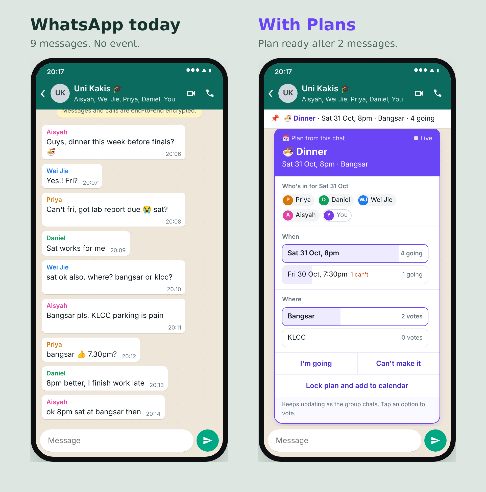
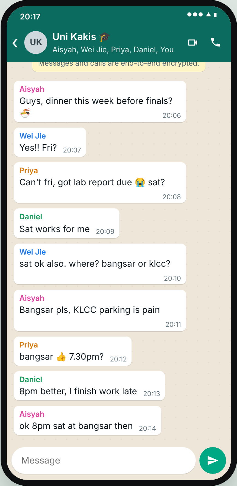
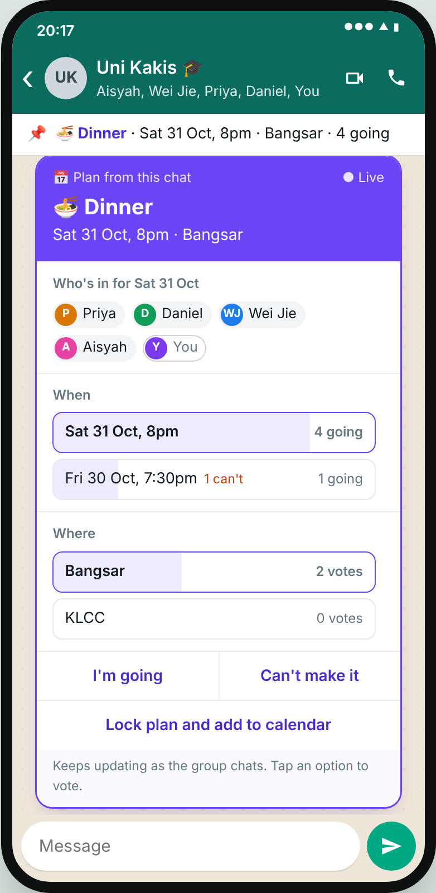
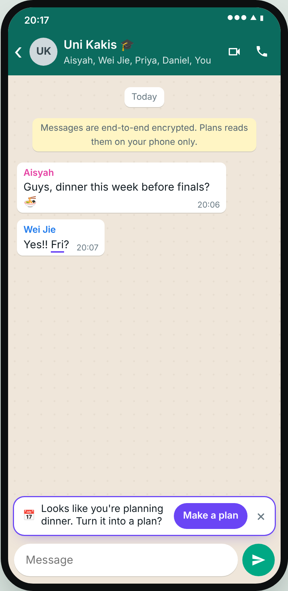

# Plans for WhatsApp — group chats that plan themselves

**Hack to the Future submission.** App upgraded: **WhatsApp** (group chats). New feature: **Plans**.

**Live demo:** https://shermaineyap.github.io/hack-to-the-future/



## The problem

Every WhatsApp group eventually tries to meet up, and the plan drowns in "fri?" "can't" "sat?" "where ah?". WhatsApp has polls and events, but someone still has to read the whole argument, work out who can make which day, and create the event by hand — so in most groups it never happens. It hits every friend group, family chat and project team that tries to organise anything.

## The feature

Plans notices when a group is organising something and turns the back-and-forth into **one live plan** inside the chat:

1. **It notices.** After a couple of planning messages, a quiet suggestion appears above the keyboard: *"Looks like you're planning dinner. Turn it into a plan?"*
2. **It builds the plan from what people already said.** Days, times, places and replies like "can't fri", "sat ok", "bangsar 👍" become a card with the leading day and time, the leading place, and who's in, out or still to reply.
3. **It keeps up.** The card updates as the conversation continues — nobody has to re-vote when someone says "8pm better".
4. **One tap to answer, one tap to lock.** "I'm going" / "Can't make it", tap a day or place to vote, then lock the plan and add it to your calendar (a real `.ics` file).

| Before (WhatsApp today) | After (with Plans) |
|---|---|
|  |  |

The suggestion that starts it:



## Try it

Open the [live demo](https://shermaineyap.github.io/hack-to-the-future/) and:

- Switch between **WhatsApp today** and **With Plans** to compare.
- Press **Play the conversation**, or use **Next message** (or the → key) to step through.
- Tap **Make a plan** when the suggestion appears, then keep playing and watch the card update.
- Type your own messages as "You", e.g. `can't sat, sun?` or `KLCC better`.
- Add `?autoplay` to the URL to start playing immediately, or `?mode=before` to open on today's app.

## Run it locally

No build step and no dependencies.

```bash
git clone https://github.com/ShermaineYap/hack-to-the-future.git
cd hack-to-the-future
python3 -m http.server 5173     # or: npm start
# open http://localhost:5173
```

Run the tests (Node 18+):

```bash
npm test
```

## How it works

```
message ─▶ split into clauses ─▶ detect activity · days · times · places · yes/no
                                          │
                                          ▼
                    live plan: candidate slots (per-person RSVPs) + places (votes)
                                          │
                       ranked: most "yes", fewest "can't", most recent
                                          ▼
                     suggestion ▶ Plan card ▶ pinned summary ▶ .ics export
```

- **`src/planner.js`** — the Plans engine. Rule-based and deterministic: it resolves "fri", "tmr", "this weekend" to real dates, reads times like `7.30pm`, recognises places, and treats "can't", "busy" as no and "ok", "works", "👍" as yes. A reply with no day ("ok also") applies to the day currently being discussed. Planning is suggested once enough signals add up, so ordinary chat ("lol did you see that meme") never triggers it.
- **`src/app.js`** — the chat screen recreation, the suggestion, the live Plan card, the pinned summary and calendar export.
- **`tests/planner.test.js`** — 10 tests covering date resolution, times, clause splitting, availability, place votes, the full demo conversation, and calendar output.

**Privacy by design:** the engine runs entirely on the device, so it fits WhatsApp's end-to-end encryption — message text never has to leave the phone for this to work.

### Tools, languages and models

- HTML, CSS, vanilla JavaScript (ES modules) — no framework, no build step
- Node.js built-in test runner (`node:test`)
- GitHub Pages for hosting
- Google Fonts: Bricolage Grotesque, Instrument Sans
- Playwright (headless Chromium) to capture the screenshots
- No AI model at runtime: the planning engine is rule-based so it works offline and on-device
- Built with help from Claude (Anthropic) as an AI coding assistant

## How WhatsApp could roll it out

Ship Plans as an upgrade to the existing **Events** feature in groups: on-device detection only, off by default per group with a one-time opt-in, starting with the most common plans (meals, meetups) in a few languages, then expanding the date and place vocabulary per region.

## Team

- Shermaine Yap — shermaine8268@gmail.com

## Disclaimer

Independent concept built for the Hack to the Future hackathon. Not affiliated with, endorsed by, or connected to WhatsApp or Meta. The chat screen is a recreation with made-up people and sample messages; no real user data is used.

## License

MIT
